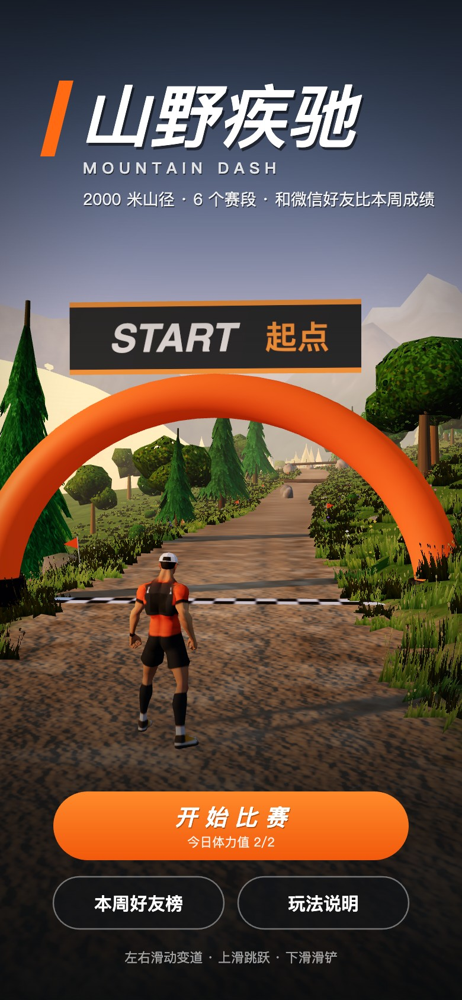
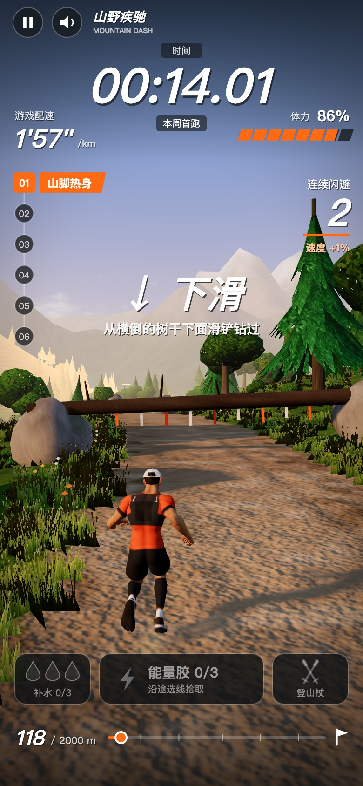
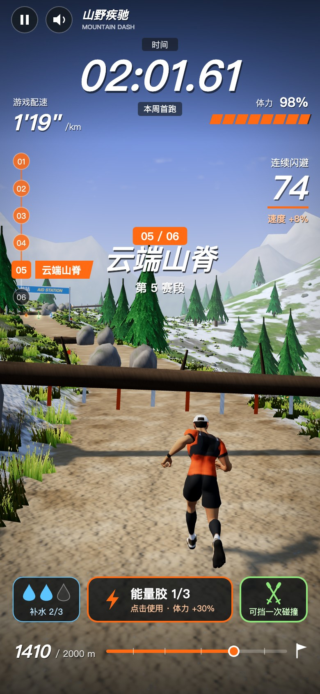
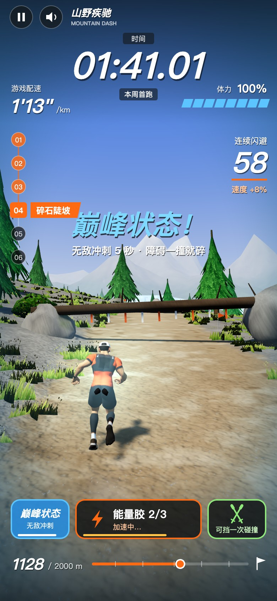

# 山野疾驰 Mountain Dash

一款越野跑题材的 3D 跑酷微信小游戏：在 2000 米的山径上滑动变道、跳跃、滑铲，管理体力跑完六个赛段，再和微信好友比本周成绩。

用 [Three.js](https://threejs.org/) 渲染，esbuild 打包，不依赖游戏引擎，没有后端服务。

<p>
  
  
  
  
</p>

## 玩法

- **操作**：左右滑动变道绕开落石，上滑跳过倒木，下滑从横倒的树干下钻过。
- **体力**：奔跑持续消耗体力，上坡更快，撞到障碍会减速并扣体力；体力耗尽即退赛。
- **补给**：能量胶（回体力并加速）、水（攒满 3 瓶进入无敌的“巅峰状态”）、登山杖（挡一次碰撞），沿途和补给站拾取。
- **赛段**：山脚热身、第一道山脊、密林穿越、碎石陡坡、云端山脊、冲刺终点，越往后越快、障碍越密；每一局的障碍和补给随机排布。
- **好友榜**：每周保留最好的一次成绩，和玩过的微信好友排名，每周一 0 点（北京时间）重置。
- **体力值**：每天 2 点，每局消耗 1 点，用完后转发给好友可再跑一局（也可以切换成看激励视频广告）。

## 快速开始

需要 Node.js 18 或更高版本。

```bash
npm install
npm run dev
```

然后在浏览器打开 <http://localhost:5173/preview/>。预览页用 `preview/wx-shim.js` 模拟了游戏用到的微信接口（好友榜、转发、广告都是假数据），改动 `src/` 后会自动重新打包，刷新即可。

键盘操作：方向键或 `WASD` 控制跑者，空格跳跃，`E` 吃能量胶，`P` / `Esc` 暂停，回车确认。

| 命令 | 作用 |
| --- | --- |
| `npm run dev` | 开发版打包 + 监听改动 + 预览服务器 |
| `npm run build` | 生产版打包，输出 `minigame/game.js`（约 685 KB） |
| `npm run build:dev` | 开发版打包（带 sourcemap，体积约 4.6 MB） |
| `npm run preview` | 只启动预览服务器 |

## 在微信里运行

1. 执行 `npm run build`。开发版的 `game.js` 超过小游戏主包 4 MB 的限制，上传前必须用生产版。
2. 用[微信开发者工具](https://developers.weixin.qq.com/minigame/dev/devtools/download.html)导入 `minigame/` 目录。
3. 把 `minigame/project.config.json` 里的 `appid` 换成你自己的小游戏 AppID。
4. 好友榜用到“微信朋友关系”，需要在小游戏后台的用户隐私保护指引里声明。

## 配置

玩法数值都在 `src/config.js` 里，常用的几项：

| 配置 | 说明 |
| --- | --- |
| `ENERGY.enabled` | 是否限制每天能跑几局 |
| `ENERGY.dailyFree` | 每天免费的体力值，默认 2 |
| `ENERGY.refill` | 体力值用完后怎么再跑一局：`'share'` 转发给好友，`'ad'` 看激励视频 |
| `ENERGY.adUnitId` | 激励视频广告位 ID，`refill` 为 `'ad'` 时需要 |
| `RIVALS_ENABLED` | 是否在赛道上加入电脑对手，默认关闭 |
| `STAGES` | 六个赛段的长度、速度、坡度、障碍密度和天气 |
| `PLAYER` | 跳跃、滑铲、体力、补给效果等手感参数 |

## 预览调试参数

预览地址后面可以加参数，例如 `http://localhost:5173/preview/?seed=11&friends=20`：

| 参数 | 作用 |
| --- | --- |
| `seed=数字` | 固定赛道的随机排布 |
| `autopilot=1` | 自动驾驶（不消耗体力值，成绩不上榜） |
| `startAt=米数` | 从赛道中间开始 |
| `quality=0..4` | 固定画质档位，0 最高 |
| `tutorial=1` | 开头固定为教学关 |
| `friends=0\|20\|deny\|fail` | 好友榜：没有好友 / 好友很多 / 拒绝过授权 / 接口报错 |
| `share=nohide` | 模拟转发时不通知游戏切到后台的环境 |
| `ad=fail\|slow\|none` | 激励视频：拉不到 / 很慢 / 没配置广告位 |

## 目录结构

```
src/                    游戏源码
  main.js               入口：渲染器、主循环、自适应画质
  game.js               状态机、玩家与对手逻辑、跟拍相机
  config.js             赛段、手感、体力值等全部数值
  hud.js                界面：首页、比赛 HUD、成绩页、好友榜容器
  terrain.js sky.js     地形、山径、天空与大气
  obstacles.js          障碍与补给的排布和模型
  runner.js             人物模型与动画
  social.js             本周成绩、好友榜请求、转发
  energy.js ads.js      体力值、激励视频广告
  platform.js           对微信接口的薄封装
minigame/               微信小游戏工程（开发者工具导入这个目录）
  game.js               打包产物
  openDataContext/      开放数据域：绘制好友排行榜
  assets/runners/       人物模型、贴图和动画
preview/                浏览器预览页和微信接口垫片
scripts/                打包脚本和预览服务器
tools/runner-assets/    把原始人物素材加工成游戏用文件的脚本
```

## 重新生成人物素材

仓库里已经带了加工好的人物文件，一般不需要重新生成。要改人物外观时，按 `tools/runner-assets/build.py` 开头的说明操作（需要 Python 3.12，原始素材约 160 MB，不在仓库里）。

## 素材署名

- 人物与动画：[Quaternius](https://quaternius.itch.io/) Universal Base Characters / Universal Animation Library，CC0
- 太阳镜：[Glasses](https://poly.pizza/m/crbuIoq2dO) by iPoly3D，CC0
- 帽子：[Baseball cap](https://poly.pizza/m/dzfCdDABuiQ) by jeremy，[CC BY 3.0](https://creativecommons.org/licenses/by/3.0/)，已改色

本仓库的代码暂未指定开源许可证。
